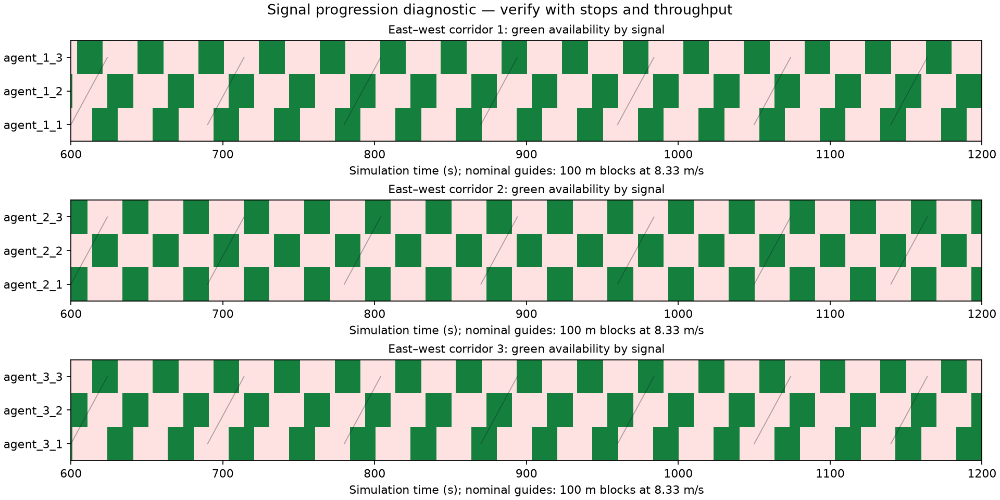

# Verified results — 29 October 2026

The **35% simulation target is exceeded**: MAPPO reduced mean completed-trip
waiting time by **43.75% versus matched independent PPO** across five previously
unused evaluation seeds. All five individual reductions exceeded 35%.
Ray RLlib training/checkpoint inference is implemented and tested. A separate
benchmark uses published Bangalore field counts. Real-city delay validation is
not claimed: the available counts do not provide city-network geometry or
measured per-vehicle waiting times.

## Frozen test results

Scenario: `configs/platoons.yaml` — nine four-approach signals, 100 m links,
one lane/direction, one-second SUMO physics, ten-second decisions, and burst
arrivals. Each episode lasts 3,600 seconds. Configured demand is 3,600 veh/h;
SUMO flow discretization produced a mean 3,804.8 entrants per test episode.
Every controller received the same demand and simulation seed in each pair.

| Controller | Waiting (s/vehicle) | Travel (s) | Completed trips | Remaining | Pending |
|---|---:|---:|---:|---:|---:|
| Fixed time | 37.67 | 94.29 | 3,705.6 | 99.2 | 0 |
| Independent PPO | 35.25 | 97.03 | 3,703.2 | 101.6 | 0 |
| MAPPO | **19.84** | **80.56** | **3,722.2** | **82.6** | **0** |
| MAPPO, messages disabled | 32.17 | 93.77 | 3,708.0 | 96.8 | 0 |

The reported reduction is the mean of paired per-seed percentages. Its 95%
percentile-bootstrap interval across evaluation seeds is **38.75–48.75%**.
The five reductions are 49.39%, 49.91%, 36.66%, 45.18%, and 37.62%.
Throughput increased slightly; the waiting improvement does not come from
completing fewer trips or leaving more vehicles pending.


## Training and selection protocol

Both algorithms started from the same independent-policy checkpoint, trained
for 10,800 joint decisions. Each then received 14,400 additional joint decisions,
for **25,200 total decisions per algorithm**. The additional training comprised
two 7,200-decision stages. Resume starts a fresh episode and deliberately skips
the previously partial episode; both algorithms use the same seed sequence.

Policy seed: 42. Training demand seeds: 3000 onward for pretraining, then 2000
onward for fine-tuning. Validation seeds 5001–5002 selected the final checkpoint:
the first stage achieved 29.5%; the second achieved 45.3%. Frozen final testing
used **6001–6005**, without further tuning. One policy seed was trained; the
interval describes evaluation-seed variability, not variability across policy
training seeds. Broader generalization needs a multi-policy-seed study.

The original wider-link scenario remains in the record: its corrected matched
controllers tied at 8.50 s, with no message benefit. It is not used to claim
43.75%. The short-link result applies to the stated burst-arrival benchmark.

## Communication and signal progression

MAPPO version 2 combines separate local actor/critic experts with a learned
directional one-hop message correction and a centralized joint-state critic.
Actors have no access to non-neighbor observations. Zero initial corrections
make the common-policy warm start exact. The queue-cost reward supplies a
persistent delay-related learning signal; training uses boundary-safe GAE.

Disabling messages after training increased test waiting from 19.84 to 32.17 s.
This supports a communication contribution in this scenario. It is an inference
ablation, not a separately retrained communication-free model.

One-second signal traces and space/time plots are saved under
`results/platoons_test_traces/`. A nominal downstream-green coverage diagnostic
averaged 46.53% for MAPPO, 29.43% for independent PPO, and 33.62% with messages
disabled. Fixed-time control scored 70.85% despite worse waiting, illustrating
that this unweighted diagnostic alone is not a performance or causality test.
The evidence supports learned signal coordination; it does not establish
globally optimal green waves or vehicle-weighted green-arrival probabilities.



## Ray RLlib

`agents/mappo/rllib_integration.py` provides a Ray 2.59 new-stack `TorchRLModule`,
`ValueFunctionAPI` centralized critic, multi-agent SUMO adapter, exported-module
controller, and a local inference API requiring only local state and four
neighbor slots. Tests verify that changing joint critic inputs cannot change
actor outputs, including after checkpoint serialization/reload.

`scripts/train_rllib.py` completed two actual PPO iterations (64 sampled joint
decisions), saved module and algorithm checkpoints under `results/rllib_smoke`,
reloaded the module and evaluated it in SUMO. This verifies the RLlib integration.
**The 43.75% result comes from the native PyTorch trainer**, not the short RLlib
smoke run; those experiments are kept separate.

## Bangalore field-count benchmark

Source: Sunil Kumar V and J. Ranjitha, IJERT 2013, DOI 10.17577/IJERTV2IS70850,
[Table 4](https://www.ijert.org/improvement-of-traffic-operations-in-congested-signalized-intersections-a-case-study-in-bangalore-city).
Six daily Bilekahalli movement counts total 95,805 vehicles. Attribution and
transcription details are in `data/bangalore/PROVENANCE.md`.

`configs/bangalore_short_links.yaml` uses the daily-average rate (3,991.875 veh/h)
and projects the observed proportions onto synthetic corridors, without random
demand perturbation. This tests transfer to a real-count-driven demand profile;
it is not a reconstruction of the actual junction. Seeds 701–703 vary SUMO
microsimulation behavior, not the source counts.

| Controller | Waiting (s/vehicle) | Completed | Remaining | Pending |
|---|---:|---:|---:|---:|
| Fixed time | 44.07 | 3,659.3 | 110.3 | 226.3 |
| Independent PPO | 40.60 | 3,582.7 | 111.3 | 302.0 |
| MAPPO | **30.91** | **3,601.0** | **98.0** | **297.0** |
| MAPPO, messages disabled | 29.58 | 3,603.0 | 95.3 | 297.7 |

MAPPO reduced waiting **23.86%** versus independent PPO here. Message removal
slightly improved this transfer result, so a communication advantage is not
claimed for the Bangalore-count profile. The demand-accounting audit matches
the normalized count target within 0.104%, including pending vehicles and SUMO
flow rounding. This is an input-replay check, not independent validation of
real-world traffic dynamics or measured waiting times.

## Verification and artifacts

**273 tests passed**, followed by 8 focused checks covering the final RLlib
local-inference serialization path. `pip check` found no broken requirements.
Yellow/all-red intervals cannot be skipped. Demand caches are fingerprinted
and locked to prevent stale scenarios or concurrent partial route writes.

- `results/acceptance.json`: explicit target check and scope.
- `results/platoons_test_comparison.json`: raw per-seed metrics, intervals,
  scenario snapshot, and checkpoint/config hashes.
- `results/platoons_mappo_14400/final.pt`: winning MAPPO checkpoint.
- `results/platoons_independent_14400/final/`: matched independent checkpoint.
- `results/bangalore_short_comparison.json`: separate count-profile transfer.
- `results/bangalore_count_replay_audit.json`: demand accounting.
- `results/platoons_progression_summary.json`: signal-alignment diagnostics.

Re-evaluate the frozen checkpoints from the project root:

```powershell
.\venv\Scripts\python.exe scripts/compare_controllers.py --config configs/platoons.yaml --mappo results/platoons_mappo_14400/final.pt --independent results/platoons_independent_14400/final --seeds 6001 6002 6003 6004 6005 --output results/reproduced_comparison.json
```

To retrain, build `configs/platoons.yaml`, run `train_controlled.py` for independent
pretraining with `--steps 10800 --demand-seed-start 3000`, initialize both algorithms
from that checkpoint for 7,200 steps, then resume each for another 7,200 steps.
Keep policy seed 42, the scenario configuration, and both stage boundaries unchanged.
