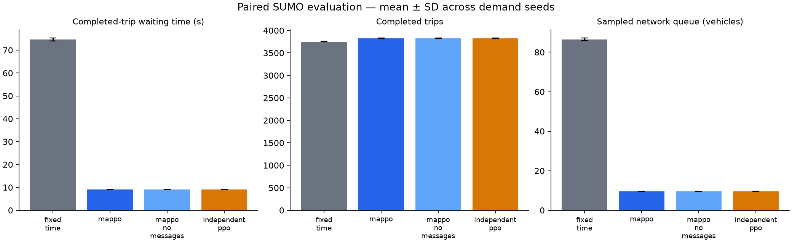

# Controller comparison

Scenario: `configs/bangalore_counts.yaml`. Seeds: [601, 602, 603]. Episode duration: 3600 seconds.

| Controller | Wait (s) | Travel (s) | Completed | Remaining | Pending | Queue |
|---|---:|---:|---:|---:|---:|---:|
| fixed_time | 74.63 | 226.59 | 3750.00 | 247.00 | 0.00 | 86.45 |
| mappo | 9.07 | 153.17 | 3825.33 | 171.67 | 0.00 | 9.58 |
| mappo_no_messages | 9.07 | 153.17 | 3825.33 | 171.67 | 0.00 | 9.58 |
| independent_ppo | 9.07 | 153.17 | 3825.33 | 171.67 | 0.00 | 9.58 |

## Measured paired waiting-time changes

- MAPPO vs fixed_time: **87.85%** mean reduction. Negative values indicate worse waiting time.
- MAPPO vs independent_ppo: **0.00%** mean reduction. Negative values indicate worse waiting time.

These are synthetic scenario results from one trained policy seed. Read waiting time together with throughput and backlog. A no-message inference ablation is not a separately retrained baseline. This comparison does not establish green waves or Bangalore validity.

