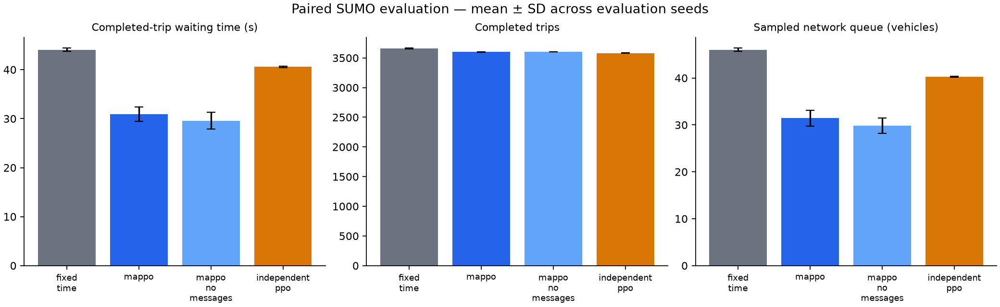

# Controller comparison

Scenario: `configs/bangalore_short_links.yaml`. Seeds: [701, 702, 703]. Episode duration: 3600 seconds.

| Controller | Wait (s) | Travel (s) | Completed | Remaining | Pending | Queue |
|---|---:|---:|---:|---:|---:|---:|
| fixed_time | 44.07 | 105.50 | 3659.33 | 110.33 | 226.33 | 46.04 |
| mappo | 30.91 | 96.81 | 3601.00 | 98.00 | 297.00 | 31.45 |
| mappo_no_messages | 29.58 | 96.21 | 3603.00 | 95.33 | 297.67 | 29.86 |
| independent_ppo | 40.60 | 107.55 | 3582.67 | 111.33 | 302.00 | 40.30 |

## Measured paired waiting-time changes

- MAPPO vs fixed_time: **29.88%** mean reduction. Negative values indicate worse waiting time.
- MAPPO vs independent_ppo: **23.86%** mean reduction. Negative values indicate worse waiting time.

These are synthetic scenario results from one trained policy seed. Read waiting time together with throughput and backlog. A no-message inference ablation is not a separately retrained baseline. This comparison does not establish green waves or Bangalore validity.

