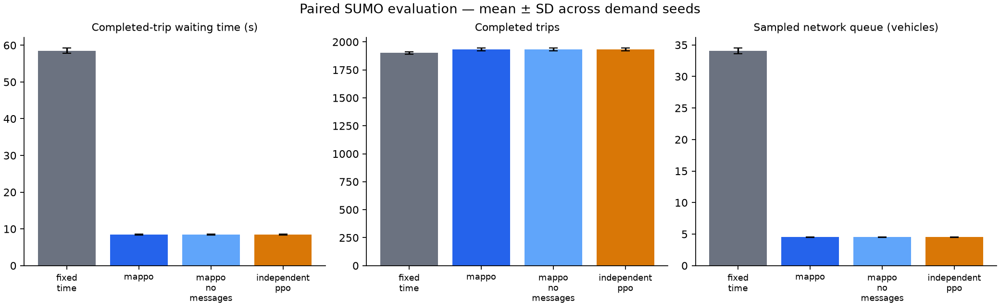

# Controller comparison

Scenario: `configs/cooperative.yaml`. Seeds: [101, 102, 103, 104, 105]. Episode duration: 3600 seconds.

| Controller | Wait (s) | Travel (s) | Completed | Remaining | Pending | Queue |
|---|---:|---:|---:|---:|---:|---:|
| fixed_time | 58.49 | 202.97 | 1901.80 | 110.60 | 0.00 | 34.07 |
| mappo | 8.50 | 149.95 | 1932.40 | 80.00 | 0.00 | 4.52 |
| mappo_no_messages | 8.50 | 149.95 | 1932.40 | 80.00 | 0.00 | 4.52 |
| independent_ppo | 8.50 | 149.95 | 1932.40 | 80.00 | 0.00 | 4.52 |

## Measured paired waiting-time changes

- MAPPO vs fixed_time: **85.48%** mean reduction. Negative values indicate worse waiting time.
- MAPPO vs independent_ppo: **0.00%** mean reduction. Negative values indicate worse waiting time.

These are synthetic scenario results from one trained policy seed. Read waiting time together with throughput and backlog. A no-message inference ablation is not a separately retrained baseline. This comparison does not establish green waves or Bangalore validity.

