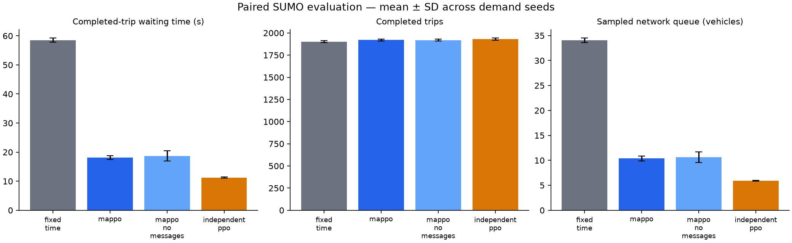

# Controller comparison

Scenario: `configs/coordination.yaml`. Seeds: [101, 102, 103, 104, 105]. Episode duration: 3600 seconds.

| Controller | Wait (s) | Travel (s) | Completed | Remaining | Pending | Queue |
|---|---:|---:|---:|---:|---:|---:|
| fixed_time | 58.49 | 202.97 | 1901.80 | 110.60 | 0.00 | 34.07 |
| mappo | 18.12 | 161.24 | 1921.20 | 91.20 | 0.00 | 10.37 |
| mappo_no_messages | 18.65 | 161.87 | 1919.60 | 92.80 | 0.00 | 10.65 |
| independent_ppo | 11.25 | 152.92 | 1929.80 | 82.60 | 0.00 | 5.91 |

## Measured paired waiting-time changes

- MAPPO vs fixed_time: **69.00%** mean reduction. Negative values indicate worse waiting time.
- MAPPO vs independent_ppo: **-61.25%** mean reduction. Negative values indicate worse waiting time.

These are synthetic scenario results from one trained policy seed. Read waiting time together with throughput and backlog. A no-message inference ablation is not a separately retrained baseline. This comparison does not establish green waves or Bangalore validity.

