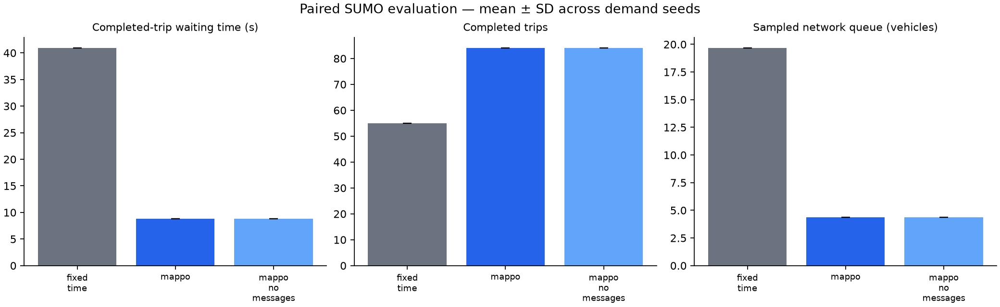

# Controller comparison

Scenario: `configs/coordination.yaml`. Seeds: [101]. Episode duration: 300 seconds.

| Controller | Wait (s) | Travel (s) | Completed | Remaining | Pending | Queue |
|---|---:|---:|---:|---:|---:|---:|
| fixed_time | 40.89 | 173.07 | 55.00 | 111.00 | 0.00 | 19.66 |
| mappo | 8.85 | 145.36 | 84.00 | 82.00 | 0.00 | 4.38 |
| mappo_no_messages | 8.85 | 145.36 | 84.00 | 82.00 | 0.00 | 4.38 |

## Measured paired waiting-time changes

- MAPPO vs fixed_time: **78.37%** mean reduction. Negative values indicate worse waiting time.

These are synthetic scenario results from one trained policy seed. Read waiting time together with throughput and backlog. A no-message inference ablation is not a separately retrained baseline. This comparison does not establish green waves or Bangalore validity.

