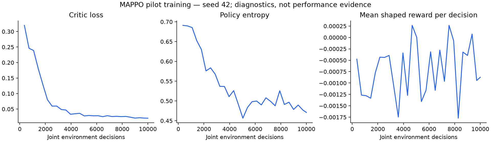

# Local validation — 28 October 2026

The core coordination implementation is present and runnable. The reference's
35% advantage over independent agents, green-wave explanation, Bangalore
validation, and Ray RLlib technology claim are **not established**.

## Implemented

- Native PyTorch MAPPO: shared actor, directional one-hop learned messages,
  centralized per-agent critic, clipped PPO, entropy bonus, gradient clipping,
  KL stopping, boundary-safe GAE, and save/load/resume support.
- A separate synthetic 3×3 scenario with 25 nodes, 80 directed edges, nine
  four-approach signals, six phases per signal, and 108 lane connections.
- Three observed lanes per approach, giving 50 local features per agent.
- Twelve straight corridor flows; target demand 2,000 vehicles/hour.
- Paired held-out evaluation, message ablation, JSON reports, and charts.
- Correct simulation time at reset and internal time-limit bootstrapping in
  the independent PPO training path.

## Training evidence

Validation: **265 tests pass**, plus a 12-decision independent PPO training
smoke run exercising the corrected internal time-limit path. SUMO emitted 26
existing deprecated-API warnings during the full suite; there were no failures.

Both pilot controllers trained for 10,000 joint environment decisions with
policy seed 42. MAPPO completed 28 updates, independent PPO 27. The independent
trainer's legacy `global_step` metadata counts individual agent transitions
(90,000 at the end); its CLI target counts joint decisions (10,000).

MAPPO critic loss changed from 0.31987 to 0.02062. Losses stayed finite.
This supports a functioning optimizer and value fit, not a claim of improved
traffic performance or convergence.

Checkpoints:

- `results/mappo_coordination_10k/final.pt`
- `results/independent_coordination_10k/checkpoints/final/`

## Held-out evaluation

Each controller was evaluated with demand and SUMO seeds 101–105, using the
same demand for each paired run. Requested and evaluated duration is 3,600
seconds per seed. Values below are means across the five demand seeds.
Waiting/travel times use completed trips; backlog and throughput are included
to expose completion bias. Queue length is sampled at decisions.

| Controller | Wait (s/vehicle) | Travel (s) | Completed | Remaining | Queue |
|---|---:|---:|---:|---:|---:|
| Fixed time | 58.49 | 202.97 | 1,901.8 | 110.6 | 34.07 |
| MAPPO | 18.12 | 161.24 | 1,921.2 | 91.2 | 10.37 |
| MAPPO, messages disabled | 18.65 | 161.87 | 1,919.6 | 92.8 | 10.65 |
| Independent PPO | 11.25 | 152.92 | 1,929.8 | 82.6 | 5.91 |

MAPPO improves over fixed-time control, but **underperforms independent PPO**
in this pilot. The message ablation has only a small effect. No 35% reduction
versus independent agents is supported, and no green-wave mechanism is
demonstrated. Do not use the reference image's result claims in a resume or
report on the basis of this experiment.

Machine-readable evidence and paired reductions are in
`results/coordination_comparison.json`; the companion chart/report is generated
by `scripts/report_comparison.py`.

## Interpretation limits and remaining work

This is an exploratory pilot with one trained policy seed per algorithm and
five held-out demand seeds. It is not a controlled multi-policy-seed study.
MAPPO training used the static seed-42 demand; independent PPO varied training
demand seeds from 1000 onward. The policies trained before the reset-time
correction; evaluation uses corrected timing. The independent checkpoint also
predates the internal time-limit bootstrap correction added during review.
Retrain both policies with matching demand schedules on the corrected code
before making a formal algorithm comparison. An inference message ablation
is not a separately retrained communication-free policy.

The network is synthetic with straight routes, not a calibrated city network.
`data/bangalore/` contains only `.gitkeep`. Real-data validation requires an
actual dataset, provenance, calibration, and held-out measured observations.
The user has been asked for a dataset path/source. Ray RLlib is not integrated;
the implemented framework is PyTorch. Further research is needed to establish
an advantage over independent PPO and diagnose signal synchronization along
corridors.
