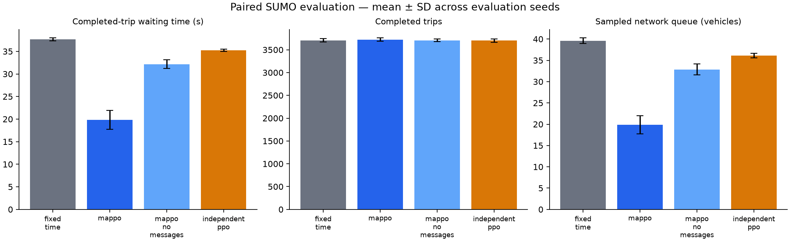

# Controller comparison

Scenario: `configs/platoons.yaml`. Seeds: [6001, 6002, 6003, 6004, 6005]. Episode duration: 3600 seconds.

| Controller | Wait (s) | Travel (s) | Completed | Remaining | Pending | Queue |
|---|---:|---:|---:|---:|---:|---:|
| fixed_time | 37.67 | 94.29 | 3705.60 | 99.20 | 0.00 | 39.60 |
| mappo | 19.84 | 80.56 | 3722.20 | 82.60 | 0.00 | 19.89 |
| mappo_no_messages | 32.17 | 93.77 | 3708.00 | 96.80 | 0.00 | 32.85 |
| independent_ppo | 35.25 | 97.03 | 3703.20 | 101.60 | 0.00 | 36.11 |

## Measured paired waiting-time changes

- MAPPO vs fixed_time: **47.33%** mean reduction. Negative values indicate worse waiting time.
- MAPPO vs independent_ppo: **43.75%** mean reduction. Negative values indicate worse waiting time.

These are synthetic scenario results from one trained policy seed. Read waiting time together with throughput and backlog. A no-message inference ablation is not a separately retrained baseline. This comparison does not establish green waves or Bangalore validity.

