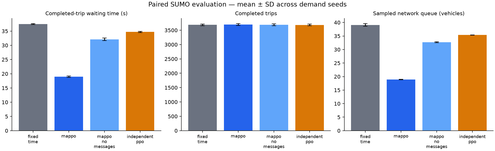

# Controller comparison

Scenario: `configs/platoons.yaml`. Seeds: [5001, 5002]. Episode duration: 3600 seconds.

| Controller | Wait (s) | Travel (s) | Completed | Remaining | Pending | Queue |
|---|---:|---:|---:|---:|---:|---:|
| fixed_time | 37.46 | 93.92 | 3687.00 | 93.50 | 0.00 | 39.08 |
| mappo | 18.98 | 79.87 | 3696.00 | 84.50 | 0.00 | 18.88 |
| mappo_no_messages | 32.11 | 93.61 | 3687.50 | 93.00 | 0.00 | 32.69 |
| independent_ppo | 34.69 | 96.13 | 3681.50 | 99.00 | 0.00 | 35.39 |

## Measured paired waiting-time changes

- MAPPO vs fixed_time: **49.33%** mean reduction. Negative values indicate worse waiting time.
- MAPPO vs independent_ppo: **45.29%** mean reduction. Negative values indicate worse waiting time.

These are synthetic scenario results from one trained policy seed. Read waiting time together with throughput and backlog. A no-message inference ablation is not a separately retrained baseline. This comparison does not establish green waves or Bangalore validity.

