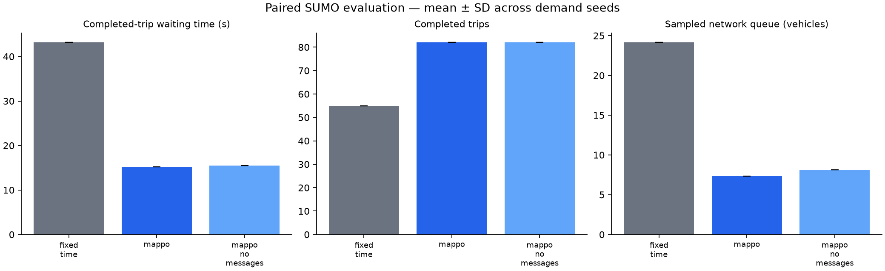

# Controller comparison

Scenario: `configs/cooperative.yaml`. Seeds: [105]. Episode duration: 300 seconds.

| Controller | Wait (s) | Travel (s) | Completed | Remaining | Pending | Queue |
|---|---:|---:|---:|---:|---:|---:|
| fixed_time | 43.15 | 182.07 | 55.00 | 118.00 | 0.00 | 24.14 |
| mappo | 15.16 | 155.88 | 82.00 | 91.00 | 0.00 | 7.34 |
| mappo_no_messages | 15.49 | 156.38 | 82.00 | 91.00 | 0.00 | 8.14 |

## Measured paired waiting-time changes

- MAPPO vs fixed_time: **64.87%** mean reduction. Negative values indicate worse waiting time.

These are synthetic scenario results from one trained policy seed. Read waiting time together with throughput and backlog. A no-message inference ablation is not a separately retrained baseline. This comparison does not establish green waves or Bangalore validity.

